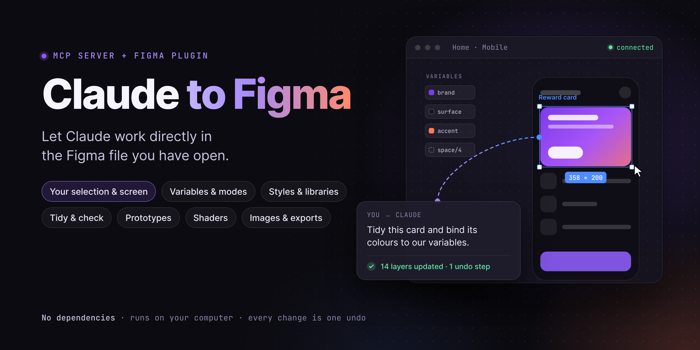

<p align="center"></p>

# Claude to Figma (Claude Bridge)

[English](README.md) · **Tiếng Việt**

Cầu nối cho Claude làm việc trực tiếp trong file Figma bạn đang mở. Claude có thể vẽ màn hình, sửa layer, chạy mọi đoạn code Figma Plugin API, và chụp màn hình để tự kiểm tra kết quả.

```
Claude ──(MCP, stdio)──► server/index.js ──(WebSocket, chỉ trong máy)──► plugin "Claude Bridge" trong Figma desktop
```

- **Biết bạn đang làm gì.** Claude đọc được vùng chọn (cả đoạn text đang sửa), phần canvas đang hiện trên màn hình và những thao tác vài phút gần đây, nên chỉ cần nói "sửa cái này", "làm giống chỗ này".
- **Thấy cái bạn đang thấy.** `screenshot` chụp một layer, vùng quanh các layer đang chọn, hoặc đúng phần đang hiện trên màn hình.
- **Bạn thấy Claude đã làm gì.** Cửa sổ plugin liệt kê từng lệnh với tóm tắt dễ hiểu ("Changed 6 layers"), nút **Show** để chọn và zoom tới đúng các layer vừa bị sửa, và một thông báo trên canvas sau mỗi lần sửa. Các thay đổi chạy lần lượt, mỗi cái đúng một lần Cmd+Z. Tắt **Allow changes** để Claude chỉ được xem, không được sửa; **Save version** để lưu điểm khôi phục.
- **Đọc thiết kế để viết code.** `get_spec` trả về cả frame với giá trị dùng ngay cho CSS (px, fill/hug, flexbox, border, shadow, typography, đoạn text nhiều style), tên `{token}` kèm code syntax, component kèm property, và instance lặp lại chỉ liệt kê một lần, nên code Claude viết ra khớp thiết kế.
- **Layer mới nằm cạnh chỗ bạn làm.** Màn hình, ảnh, instance Claude thêm vào sẽ nằm bên phải phần bạn đang chọn hoặc đang xem, không bao giờ đè lên frame của bạn.
- **Variables, styles và library.** Tạo, sửa variable, mode, alias, gắn variable vào layer, tạo style, dùng và import component, style, variable từ library.
- **Shader.** Xem các shader file đang dùng được và áp chúng làm fill, stroke hoặc effect, chỉnh property theo tên (màu, số, điểm, gradient, variable).
- **Dọn dẹp và soát thiết kế.** `audit_design` tìm tên layer mặc định, giá trị hard-code trùng variable, spacing lệch grid, lệch pixel, chữ thiếu tương phản…, và tự sửa phần an toàn. `update_nodes` sửa hàng loạt layer một lần: text, style, variant, auto layout, link prototype.
- **Làm cả với file trên máy.** Đưa ảnh từ thư mục hoặc link vào thiết kế, export icon và màn hình thẳng vào thư mục code.
- **Nhiều file cùng lúc.** Mở plugin ở cả file library và file sản phẩm, Claude làm được ở cả hai.
- **Thao tác nhanh.** Có sẵn các prompt: Tidy and polish, Check design, Generate a design, Viết lại/dịch text, Sửa variables, Làm prototype, Bàn giao code, Sửa library.
- **Dùng được toàn bộ Plugin API.** Plugin Figma làm được gì thì Claude làm được nấy qua `run_code`.
- **Nhẹ cho Claude.** 23 tool chỉ tốn khoảng 7K token (các MCP server kiểu mỗi lệnh một tool thường 25K+), kết quả gọn và giới hạn khoảng 20K token kèm ghi chú cách lấy phần còn lại, tool chỉ đọc được đánh dấu để bạn cho phép luôn.
- **Không cần cài thư viện, chỉ chạy trong máy.** Server là một file Node.js (Node 18+) chỉ nghe trên `127.0.0.1` / `::1`; plugin là JavaScript thuần. Nhiều cửa sổ Claude (desktop, Cowork, Claude Code) dùng chung một kết nối.

---

## Mục lục

1. [Cần có gì](#cần-có-gì)
2. [Cài nhanh (macOS + Claude desktop)](#cài-nhanh-macos--claude-desktop)
3. [Cài đặt chi tiết](#cài-đặt-chi-tiết)
4. [Sử dụng hằng ngày](#sử-dụng-hằng-ngày)
5. [Thao tác nhanh](#thao-tác-nhanh)
6. [Library và nhiều file](#library-và-nhiều-file)
7. [Danh sách công cụ](#danh-sách-công-cụ)
8. [Viết `run_code` cho tốt](#viết-run_code-cho-tốt)
9. [Cách hoạt động](#cách-hoạt-động)
10. [Xử lý lỗi](#xử-lý-lỗi)
11. [An toàn](#an-toàn)
12. [Gỡ cài đặt](#gỡ-cài-đặt)
13. [Phát triển](#phát-triển)

---

## Cần có gì

| Thứ cần | Ghi chú |
|---|---|
| **Figma desktop** | Plugin dạng development chỉ import và chạy được trong app desktop (macOS hoặc Windows), không chạy trên trình duyệt. Dùng cho file Figma Design. Chưa hỗ trợ FigJam, Slides và Dev Mode. |
| **Node.js 18 trở lên** | Kiểm tra bằng lệnh `node -v` trong Terminal. Tải bản LTS tại <https://nodejs.org>. |
| **Một MCP client** | Claude desktop (chat và Cowork), Claude Code, hoặc client bất kỳ chạy được MCP server qua stdio. |

---

## Cài nhanh (macOS + Claude desktop)

```bash
git clone https://github.com/datntfe/claude-to-figma.git
cd claude-to-figma
bash install-mac.sh
```

Script cài đặt sẽ:

- chép bridge vào `~/claude-figma-bridge`.
- thêm mục `figma-bridge` vào `~/Library/Application Support/Claude/claude_desktop_config.json`. Script sao lưu file cũ (có gắn ngày giờ) trước khi ghi, giữ nguyên các MCP server bạn đang có, và dừng lại không ghi gì nếu file hiện tại không phải JSON hợp lệ.

Sau đó:

1. **Thoát hẳn Claude** (Cmd+Q, không chỉ đóng cửa sổ) rồi mở lại.
2. Trong **Figma desktop**, mở một file design và chọn **Plugins → Development → Import plugin from manifest…**. Chọn file `~/claude-figma-bridge/figma-plugin/manifest.json`.
3. Chạy **Plugins → Development → Claude Bridge**. Thấy chấm xanh là đã kết nối.
4. Nhắn Claude: *"Kiểm tra trạng thái Figma bridge."*

---

## Cài đặt chi tiết

### 1. Lấy code về

Chọn một trong hai cách:

- `git clone https://github.com/datntfe/claude-to-figma.git`
- Trên GitHub bấm **Code → Download ZIP** rồi giải nén.

Đặt thư mục ở chỗ cố định. Mỗi lần mở, Claude sẽ chạy server từ đường dẫn này.

### 2. Khai báo MCP server

Làm theo mục ứng với client bạn dùng. Client nào cũng cần hai thứ: **đường dẫn tuyệt đối tới `node`** và **đường dẫn tuyệt đối tới `server/index.js`**.

Tìm đường dẫn `node`:

- macOS / Linux: `which node`, ví dụ `/usr/local/bin/node` hoặc `/opt/homebrew/bin/node`
- Windows: `where node`, ví dụ `C:\Program Files\nodejs\node.exe`

#### A. Claude desktop trên macOS (dùng script)

Chạy `bash install-mac.sh` như phần cài nhanh. Mỗi lần kéo bản mới về thì chạy lại script này. Script sẽ ghi đè `~/claude-figma-bridge` và cập nhật mục cấu hình.

#### B. Claude desktop, sửa cấu hình bằng tay (macOS hoặc Windows)

Mở file cấu hình. Trong Claude desktop, bạn cũng có thể vào **Settings → Developer → Edit Config**.

| Hệ điều hành | File cấu hình |
|---|---|
| macOS | `~/Library/Application Support/Claude/claude_desktop_config.json` |
| Windows | `%APPDATA%\Claude\claude_desktop_config.json` |

Thêm `figma-bridge` vào trong `mcpServers` và giữ nguyên các server đang có.

macOS:

```json
{
  "mcpServers": {
    "figma-bridge": {
      "command": "/opt/homebrew/bin/node",
      "args": ["/Users/ban/claude-to-figma/server/index.js"]
    }
  }
}
```

Windows (dấu `\` phải viết thành `\\`):

```json
{
  "mcpServers": {
    "figma-bridge": {
      "command": "C:\\Program Files\\nodejs\\node.exe",
      "args": ["C:\\Users\\ban\\claude-to-figma\\server\\index.js"]
    }
  }
}
```

Lưu file, thoát hẳn Claude rồi mở lại.

#### C. Claude Code

```bash
claude mcp add --scope user figma-bridge -- node /duong/dan/tuyet/doi/claude-to-figma/server/index.js
claude mcp list        # phải thấy figma-bridge
```

`--scope user` giúp mọi project đều dùng được. Bỏ cờ này thì server chỉ thêm cho project hiện tại. Trong phiên làm việc, gõ `/mcp` để xem server đã kết nối chưa.

#### D. MCP client khác

Đây là MCP server chuẩn chạy qua stdio:

- command: `node`
- args: `["/duong/dan/tuyet/doi/server/index.js"]`
- env (không bắt buộc): `FIGMA_BRIDGE_PORT`

#### Đổi cổng (không bắt buộc)

Cổng mặc định là **3055**. Muốn đổi thì phải sửa cả 3 chỗ:

1. **Server:** đặt `FIGMA_BRIDGE_PORT` trong cấu hình client, ví dụ thêm `"env": { "FIGMA_BRIDGE_PORT": "3056" }` cạnh `command`/`args`. Với Claude Code thì dùng `claude mcp add -e FIGMA_BRIDGE_PORT=3056 …`.
2. **Manifest của plugin:** Figma chỉ cho plugin mở những địa chỉ khai báo trong `figma-plugin/manifest.json`. Sửa cả hai dòng trong `devAllowedDomains` sang cổng mới.
3. **Cửa sổ plugin:** nhập cổng mới vào ô **Port** rồi bấm **Reconnect**. Sau khi sửa manifest thì đóng plugin và chạy lại.

### 3. Import plugin vào Figma (mỗi máy làm một lần)

1. Mở **Figma desktop** và một file design bất kỳ.
2. Vào **Plugins → Development → Import plugin from manifest…**. Cũng có thể bấm Cmd+/ (Ctrl+/) rồi gõ "Import plugin from manifest".
3. Chọn `figma-plugin/manifest.json`. Nếu cài bằng script thì file nằm ở `~/claude-figma-bridge/figma-plugin/manifest.json`.

Import **đúng file manifest của repo này**. Đừng tạo plugin mới bằng "New plugin…" của Figma, vì cách đó sinh ra template TypeScript cần build, không phải plugin này.

### 4. Kiểm tra mọi thứ đã chạy

1. Khi Claude đang mở, vào <http://localhost:3055> trên trình duyệt. Phải thấy dòng `Claude Figma bridge 1.3.0 is running. Plugin connected: no`.
2. Trong Figma, chạy **Plugins → Development → Claude Bridge**. Chấm chuyển **xanh**, kèm dòng "Connected: Claude can work in “tên file”."
3. Tải lại trang trình duyệt. Lúc này phải thấy `Plugin connected: yes`.
4. Nhắn Claude *"Kiểm tra trạng thái Figma bridge."* Claude sẽ trả lời kèm tên file và page bạn đang mở.

---

## Sử dụng hằng ngày

1. Mở file Figma bạn muốn Claude làm việc. Nên dùng file làm việc riêng hoặc một page nhân bản.
2. Chạy **Plugins → Development → Claude Bridge**. Những lần sau có thể mở lại từ **Plugins → Development**, danh sách plugin gần đây, hoặc phím tắt Cmd+Option+P (Ctrl+Alt+P).
3. **Để cửa sổ plugin mở** trong suốt lúc Claude làm. Đóng cửa sổ là Claude mất kết nối. Bạn có thể kéo, thu nhỏ, hoặc kéo góc dưới bên phải để đổi kích thước (lần sau mở vẫn giữ).
4. Nhắn Claude việc cần làm bằng lời bình thường.

Cửa sổ plugin hiển thị:

| Thành phần | Ý nghĩa |
|---|---|
| 🟢 chấm xanh | Đã kết nối với bridge |
| 🟠 chấm cam | Đang kết nối |
| 🔴 chấm đỏ | Chưa kết nối. Plugin tự thử lại mỗi 2 giây. |
| Dòng thời gian | Mỗi lệnh một dòng: tóm tắt ("Created 14 layers", "Read the design (32 layers)"), thời gian chạy và giờ. Lệnh sửa có nhãn "↶ 1 undo"; lệnh chỉ đọc hiện mờ. Bấm vào dòng để xem yêu cầu và kết quả. |
| **Show** | Chọn các layer mà lệnh đó đụng tới và zoom tới (tối đa 400%). Thông báo Figma hiện sau mỗi lần sửa cũng có nút này. |
| **Allow changes** | Tắt: Claude vẫn xem được file này nhưng mọi thay đổi bị từ chối, kèm lời nhắn để Claude hỏi bạn. |
| **Changes only** | Ẩn các lệnh chỉ đọc khỏi dòng thời gian. |
| **Save version** | Lưu "Before Claude · 14:32" vào lịch sử phiên bản của file. |
| Copy log · Port · Reconnect | Chép dòng thời gian dạng text, đổi cổng, hoặc buộc kết nối lại. |

### Ví dụ yêu cầu

- *"Mình đang làm gì đây? Sửa cái card đang chọn cho đồng bộ với mấy card khác trên màn hình."*
- *"Dọn dẹp frame này."* · *"Soát màn này xem có lỗi tương phản, lệch design system không."*
- *"Dịch toàn bộ text trong các màn đang chọn sang tiếng Anh, giữ ngắn gọn."*
- *"Thêm mode Dark cho collection Theme, lấy giá trị từ dải màu gray."*
- *"Thiết kế popup nhận thưởng bằng component Button, Card và các color variable của mình, đặt cạnh màn Home."*
- *"Lấy ảnh trong ~/Pictures/pets đặt vào 4 card."* · *"Export các icon trên page này ra SVG vào ~/code/app/assets/icons."*
- *"Nối mọi nút 'Continue' sang màn tiếp theo bằng Smart Animate."*

Thường Claude gọi `get_context` để hiểu bạn đang nói tới chỗ nào, làm việc bằng các công cụ bên dưới, rồi `screenshot` để kiểm tra và `focus` để đưa màn hình của bạn tới chỗ vừa sửa.

### Mẹo

- **Mỗi thay đổi của Claude là một lần Cmd+Z.** Mỗi lần gọi công cụ là một bước undo riêng trong Figma. Trước khi sửa lớn, Claude có thể lưu một version có tên (`save_version`) để quay lại từ version history.
- **Chỉ cho Claude chỗ cần sửa.** Chọn layer, kéo vùng cần nói tới vào màn hình, hoặc dán link layer. Claude đọc được vùng chọn, màn hình và các thao tác gần đây (tính từ lúc mở plugin).
- **Nhiều file.** Plugin mở được ở nhiều file cùng lúc, xem [Library và nhiều file](#library-và-nhiều-file).

---

## Thao tác nhanh

Bridge có sẵn các prompt dựng sẵn, giống các gợi ý trong agent của Figma. Trong Claude desktop (chat) chúng nằm ở menu **+** mục *figma-bridge*; trong Claude Code là các lệnh như `/mcp__figma-bridge__tidy`. Hoặc cứ nói bằng lời của bạn: Claude đọc cùng quy trình đó từ mô tả công cụ.

| Prompt | Claude làm gì |
|---|---|
| **context**: Mình đang làm gì? | Xem vùng chọn, màn hình và thao tác gần đây rồi hỏi bạn muốn làm gì. |
| **tidy**: Tidy and polish | Soát vùng chọn, sửa phần an toàn (gắn variable khớp giá trị, làm tròn pixel), đặt tên layer, chỉnh spacing theo grid, thêm auto layout khi hợp lý, cho xem trước/sau. |
| **check**: Check design | Báo cáo tương phản (WCAG AA), việc dùng design system và lỗi trau chuốt. Không sửa gì. |
| **design**: Generate a design | Tìm hiểu component, style, variable của bạn rồi dựng thiết kế bằng chính chúng. |
| **text**: Viết lại hoặc dịch | Gom mọi layer text, viết lại hoặc dịch trong một lần, kiểm tra chữ tràn. |
| **tokens**: Sửa variables | Lên kế hoạch và áp dụng thay đổi variable kèm điểm khôi phục, rồi gắn vào layer. |
| **prototype**: Làm prototype | Nối nút với màn hình, có transition, back, overlay. |
| **handoff**: Bàn giao code | Export asset vào project và viết code dùng token của bạn. |
| **library**: Sửa library | Hướng dẫn từng bước sửa file library an toàn và nhắc bạn publish. |

---

## Library và nhiều file

- **Item của library chỉ đọc ở file dùng nó.** Trong file sản phẩm, Claude liệt kê, dùng, gắn và import được variable, style, component của library nhưng không sửa được. Mọi plugin Figma đều như vậy.
- **Muốn sửa library thì mở file library** và chạy Claude Bridge ở đó. Claude Bridge mở được ở nhiều file cùng lúc: file library và các file sản phẩm. Claude sửa thẳng trong file library (variable, mode, style, component), còn bạn bấm **Publish** ở panel Assets. Publish và nhận bản cập nhật vẫn làm bằng tay trong Figma.
- **File nào?** Lệnh đọc đi tới file bạn thao tác gần nhất (chọn, sửa, cuộn, chuyển tab). Khi đang mở nhiều file, lệnh sửa phải ghi rõ tên file (`file: "Savepet DS"`) để không sửa nhầm. `status` liệt kê các file đang mở.
- **Variable của library cần bật library.** Claude thấy variable của các library đã bật cho file (Assets → Libraries). Component và style của library chưa dùng trong file thì import bằng key.

---

## Danh sách công cụ

Đây là các công cụ Claude nhìn thấy. Ở vài client, tên có thêm tiền tố tên server, ví dụ `figma-bridge__run_code`. Công cụ nào cũng nhận thêm `file` để chọn file khi plugin mở ở nhiều file (xem [Library và nhiều file](#library-và-nhiều-file)).

**Xem bạn đang làm gì**

| Công cụ | Tham số | Việc |
|---|---|---|
| `status` | — | Plugin đã kết nối chưa: `role` (hub/relay), `port`, `version`, `file`, `page`, `selection` (số layer đang chọn), `plugin_version`, danh sách `files` khi mở nhiều file, và `notes` khi cần cập nhật. |
| `get_context` | `activity` (mặc định 15), `since_seconds`, `depth` (mặc định 2), `max_layers` | Bạn đang xem và làm gì: file, page, vùng chọn (và đoạn text đang sửa), viewport (zoom, vùng hiển thị, frame ở giữa màn hình, các layer đang hiện) và thao tác gần đây (chọn, sửa, tạo, xoá, đổi page, cuộn/zoom, style; do bạn, người cộng tác hay Claude làm). |
| `get_selection` | `depth` (mặc định 1), `brief` | Chi tiết từng layer đang chọn: đường dẫn, vị trí, kích thước, fill/stroke dạng hex, bo góc, effect, auto layout và sizing, text và typography, style, variable đang gắn, mode, thông tin component (main component, variant, key, library hay local, giá trị property), và các màu trong vùng chọn. |
| `screenshot` | `node_id`, `viewport`, `scale`, `max_size` (mặc định 1600) | Ảnh của một layer; hoặc `viewport: true` để chụp đúng phần đang hiện trên màn hình. Không truyền gì: layer đang chọn, vùng quanh các layer đang chọn, hoặc màn hình của bạn. |
| `get_spec` | `node_id` hoặc `ids` (mặc định: vùng chọn, không có thì frame trên màn hình), `depth`, `max_nodes` (mặc định 350), `force`, `include_hidden`, `dedupe` | Đọc sâu một lần để viết code: mọi layer với giá trị dùng ngay cho CSS, tên `{token}`, component, đoạn text nhiều style, icon gộp thành một layer, instance lặp lại chỉ một lần, kèm bảng token (code syntax, giá trị từng mode), style và component. Quá lớn → trả về danh sách các phần để đọc lần lượt. Xem [bên dưới](#get_spec-để-viết-code). |
| `get_tree` | `node_id`, `depth` (mặc định 2), `max_nodes` (mặc định 400) | Cây layer của một node, hoặc của page hiện tại, theo từng tầng; `more` đánh dấu chỗ bị lược bớt. |
| `find_nodes` | `scope` (page/selection/file) hoặc `node_id`, `type`, `name`, `text`, `component`, `limit`, `offset` | Tìm layer theo loại, tên (hoặc `/regex/`), nội dung text hay component; trả về danh sách phẳng kèm id, đường dẫn, text, font, text style. `next_offset` để lật trang danh sách dài. |
| `list_pages` | — | Danh sách page và page hiện tại. |

**Sửa thiết kế**

| Công cụ | Tham số | Việc |
|---|---|---|
| `update_nodes` | `items: [{ id \| ids, …thay đổi }]`, `save_version` | Sửa hàng loạt không cần code: tên, text, font, cỡ chữ, màu, stroke, bo góc, effect, style, auto layout (cả `mode: "AUTO"` tự suy ra từ vị trí hiện tại), sizing, variable (`'{tên}'`), mode, variant, property của component, swap, `link` prototype, `shader`, thuộc tính bất kỳ, xoá. |
| `audit_design` | `node_id` hoặc `scope`, `checks`, `fix`, `grid` (mặc định 4) | Soát thiết kế: tên mặc định, giá trị trùng variable, màu hard-code, text không có style, lệch pixel, spacing lệch grid, tương phản WCAG, vùng bấm nhỏ, layer ẩn/rỗng, frame chưa dùng auto layout. `fix: ["bind","round","autolayout"]` để tự sửa phần an toàn. |
| `build` | `spec` (object hoặc mảng), `parent_id`, `position` | Tạo layer từ mô tả JSON, kể cả instance của component local hay library, giá trị `'{variable}'`, style, mode, shader và link prototype. Đặt trên page mà không có x/y thì layer mới nằm cạnh chỗ bạn làm (`position: "auto"`, mặc định), giữa màn hình (`"viewport"`) hoặc ở 0,0 (`"origin"`). |
| `run_code` | `code` (chuỗi, bắt buộc), `timeout_ms` (mặc định 60000) | Chạy JavaScript trong plugin với toàn bộ Figma Plugin API. Trả về `{ value, logs }`. |
| `set_page` | `page_id` hoặc `name`, `create` | Chuyển page. Có `create: true` thì tạo page nếu chưa có. |
| `delete_nodes` | `ids` | Xoá layer. Không bao giờ xoá page hay cả document. |
| `focus` | `ids` | Chuyển tới đúng page, chọn layer và zoom màn hình tới đó. |

**Variables, styles và library**

| Công cụ | Tham số | Việc |
|---|---|---|
| `get_variables` | `collection`, `query`, `type`, `library`, `values`, `ids`, `limit`, `offset` | Collection local, các mode và giá trị từng mode (màu hex, `{alias}`), scope, code syntax; thêm `library: true` để xem cả variable của library đã bật (kèm key). |
| `set_variables` | `ops`, `save_version` | Một lần nhiều thao tác: tạo/đổi tên/xoá collection và mode, tạo hoặc sửa variable (giá trị theo mode, alias, scope, code syntax, mô tả, ẩn khi publish), đổi tên, xoá. Dừng ở lỗi đầu tiên và báo giá trị trước → sau. |
| `bind_variables` | `bindings`, `modes`, `save_version` | Gắn variable (local hay library, theo tên) vào fill, stroke, kích thước, spacing, padding, bo góc, opacity, ẩn/hiện, text và typography; đặt hoặc trả mode của frame theo từng collection. |
| `get_library` | `kind`, `query`, `used_remote`, `limit` | Style local kèm giá trị, component và component set local (key, variant, property), collection variable (local và library), shader (kèm property khi đã import), và các component library đang dùng trên page. |
| `set_styles` | `ops`, `save_version` | Tạo, sửa, đổi tên, xoá paint/text/effect/grid style; gắn màu và typography của style vào variable. |
| `import_from_library` | `kind`, `key`, `place`, `variant`, `parent_id`, `x`, `y`, `position` | Import variable, style, component hay component set đã publish theo key; component được đặt thành instance. |

**File trên máy bạn**

| Công cụ | Tham số | Việc |
|---|---|---|
| `place_image` | `source` (đường dẫn, link https hoặc data: URL), `node_id`, `add`, `parent_id`, `x`, `y`, `width`, `height`, `scale_mode`, `position` | PNG/JPEG/GIF thành ảnh fill (trên một layer hoặc hình chữ nhật mới); file SVG thành layer vector. |
| `export_nodes` | `ids` (mặc định vùng chọn), `format` (PNG/JPG/SVG/PDF), `scale`, `dir`, `overwrite` | Ghi file export vào thư mục (mặc định `~/Figma Exports/<tên file>`) và trả về đường dẫn. |

### Chi tiết `run_code`

`code` là **phần thân của một async function**, trong đó có sẵn:

| Tên | Là gì |
|---|---|
| `figma` | Figma Plugin API |
| `log(...args)` | Ghi dòng debug. Các dòng này trả về trong `logs`. |
| `h.solid('#RRGGBB', opacity?)` | Trả về mảng paint màu đặc cho `fills` / `strokes` |
| `h.hex('#RRGGBB')` | Trả về `{ r, g, b }` theo thang 0–1 |
| `await h.font(family, style?)` | Load font và trả về `FontName` |
| `h.svg(markup, width?)` | Tạo node từ SVG, có thể scale theo `width` |
| `h.paints(v)` | `'#RRGGBB'`, `'#RRGGBB@0.5'`, một Paint hoặc mảng các loại đó → Paint[] |
| `h.summary(node, depth?)` | Trả về mô tả JSON ngắn gọn của node |
| `h.color('#RRGGBBAA')`, `h.toHex(color)` | Đổi qua lại giữa hex và `{ r, g, b, a }` |
| `await h.describe(node)` | Chi tiết đầy đủ như `get_selection` |
| `await h.variable(tên, collection?)` | Lấy `Variable` theo tên (local, hoặc import từ library đã bật) |
| `await h.bind(node, field, tên)` | Gắn variable, ví dụ `h.bind(card, 'fill', 'color/surface')` |
| `await h.update(node, thay đổi)` | Áp dụng giống một item của `update_nodes` |
| `await h.link(node, đích, opts?)` | Link prototype (`'back'`, một node hoặc id; `{ transition, duration }`) |
| `await h.component(tên hoặc key, variant?)` | Lấy component để tạo instance (tên local hoặc `key:…`) |
| `await h.shader(node, spec)` | Áp shader, giống `shader` trong `update_nodes` (`null` để gỡ hết) |

Giá trị trả về được đổi sang JSON:

- Node thành `{ id, name, type, x, y, width, height, … }`.
- `undefined` thành `null`, function thành `"[function]"`.
- Độ sâu tối đa 4 cấp, mảng tối đa 500 phần tử, object tối đa 200 key.

Ví dụ:

```js
await figma.loadFontAsync({ family: "Inter", style: "Bold" });
const card = figma.createFrame();
card.name = "Card";
card.resize(358, 200);
card.cornerRadius = 20;
card.fills = h.solid("#15121F");
card.layoutMode = "VERTICAL";
card.paddingTop = card.paddingBottom = card.paddingLeft = card.paddingRight = 16;

const t = figma.createText();
t.fontName = { family: "Inter", style: "Bold" };
t.characters = "Daily Lucky Bonus";
t.fontSize = 20;
t.fills = h.solid("#F5F3FF");
card.appendChild(t);

figma.currentPage.appendChild(card);
figma.viewport.scrollAndZoomIntoView([card]);
log("created", card.id);
return card;
```

### Cấu trúc `build`

Cách nhanh để tạo layer mà không viết code. Mỗi phần tử có dạng:

```jsonc
{
  "type": "FRAME",              // FRAME | TEXT | RECTANGLE | ELLIPSE | SVG | SECTION | LINE
  "name": "Screen",
  "x": 0, "y": 0,
  "size": [390, 844],
  "fill": "#0A0912",            // '#RRGGBB', '#RRGGBB@0.5', một Paint hoặc Paint[]
  "stroke": "#FFFFFF@0.1",
  "radius": 16,
  "layout": {                   // chỉ cho FRAME: bật auto layout
    "mode": "VERTICAL",         // hoặc HORIZONTAL
    "gap": 12,
    "padding": [16, 16],        // số | [dọc, ngang] | [trên, phải, dưới, trái]
    "align": "MIN",             // trục phụ: MIN | CENTER | MAX
    "justify": "MIN",           // trục chính: MIN | CENTER | MAX | SPACE_BETWEEN
    "w": 390,                   // HUG | FILL | số
    "h": "HUG"
  },
  "text": "Hello",              // chỉ cho TEXT
  "font": { "family": "Inter", "style": "Bold" },
  "fontSize": 20,
  "color": "#F5F3FF",
  "svg": "<svg …>…</svg>",      // chỉ cho SVG
  "fillWidth": true,            // giãn theo chiều ngang của parent (parent có auto layout)
  "props": { "opacity": 0.9 },  // mọi thuộc tính node khác
  "children": [ /* các spec con */ ]
}
```

Dùng design system:

```jsonc
{
  "type": "FRAME", "name": "Reward", "size": [390, 844],
  "fill": "{color/bg/surface}",                    // '{tên}' gắn variable (local hoặc library)
  "layout": { "mode": "VERTICAL", "gap": "{space/4}", "padding": 16, "w": 390, "h": 844 },
  "modes": { "Theme": "Dark" },                    // mode variable cho frame này
  "children": [
    { "component": "Button", "variant": "Size=L, State=Default", "properties": { "Label": "Nhận" }, "link": "Done" },
    { "component": "key:5f1c…", "name": "Card" },  // component của library theo key
    { "type": "TEXT", "text": "Thưởng mỗi ngày", "textStyle": "Heading/M", "color": "{color/text/primary}" }
  ]
}
```

`build` trả về id của các node gốc và số layer đã tạo. Frame mới mặc định trong suốt nếu không có `fill`. `link` có thể ghi tên một layer khác tạo trong cùng lần gọi.

### Shader

`get_library` với `kind: "shaders"` liệt kê các shader file dùng được: shader có sẵn trong file, từ library đang bật và của chính bạn. `update_nodes` và `build` áp shader bằng `shader`:

```jsonc
{ "id": "12:34", "shader": { "name": "Film grain", "properties": { "Amount": 0.4, "Tint": "#7C3AED80" } } }
{ "id": "12:35", "shader": { "name": "Mesh gradient", "properties": { "Colors": ["#0A0912", "#7C3AED"], "Center": [0.5, 0.3], "Glow": "{color/brand}" } } }
{ "id": "12:35", "shader": null }   // gỡ mọi shader khỏi layer
```

- Shader được import vào file ở lần dùng đầu tiên. Từ đó `get_library` liệt kê property của nó, và kết quả `update_nodes` đầu tiên cũng ghi tên các property.
- Property ghi theo tên. Giá trị: `'#RRGGBB'` hoặc `'#RRGGBBAA'` cho màu, số, `true`/`false`, `[x, y]` cho điểm, danh sách màu (hoặc stop `{position, color}`) cho gradient, và `'{variable}'` để gắn variable.
- Shader loại effect nằm ở `effects`; shader loại fill nằm ở `fills` (trên các paint đang có) hoặc ở `strokes` với `target: "stroke"`. `replace: true` chỉ giữ lại shader, `remove: true` gỡ đúng shader đó, còn áp lại shader layer đã có thì chỉ cập nhật property.
- Plugin API của Figma áp được shader nhưng không viết được shader mới: tạo hoặc thêm shader trong Figma trước.

---

### `get_spec` để viết code

`get_spec` là thứ Claude đọc trước khi viết code từ thiết kế. Gọi một lần trên một màn hình sẽ được kiểu như:

```jsonc
{ "nodes": [{ "id": "1:2", "name": "Reward card", "type": "frame", "w": "fill", "h": "hug",
    "layout": { "dir": "column", "gap": "{space/md}", "padding": [24, 20], "align": "center" },
    "bg": "{bg/surface}", "radius": 16, "boxShadow": "0px 4px 12px 0px #00000026",
    "children": [
      { "id": "1:3", "name": "Title", "type": "text", "w": "fill", "h": "hug",
        "text": { "content": "Phần thưởng mỗi ngày", "font": "Inter", "weight": 600, "size": 20, "lineHeight": 28, "color": "{text/primary}" } },
      { "id": "1:4", "name": "Button", "type": "instance", "component": { "name": "Button", "variant": { "Size": "L" }, "props": { "Label": "Nhận" } } },
      { "id": "1:9", "name": "Button", "type": "instance", "same": "1:4" } ] }],
  "tokens": { "bg/surface": { "type": "color", "collection": "Theme", "web": "var(--bg-surface)", "modes": { "Light": "#FFFFFF", "Dark": "#111827" }, "value": "#FFFFFF" } },
  "components": { "Button": { "key": "…", "uses": 2, "variants": ["Size", "State"] } } }
```

- Kích thước là số px, `"hug"` (ôm nội dung) hoặc `"fill"` (giãn theo auto layout của cha). `layout` là flexbox; `pos` (`left`/`right`/`top`/`bottom`/`centerX`…) chỉ có ở layer đặt tự do, tính từ constraints.
- Giá trị đã gắn variable ghi là `'{name}'`, và mỗi token dùng tới được liệt kê một lần kèm code syntax và giá trị từng mode (cả mode mà frame đang dùng).
- Text pha nhiều style có `runs` (chữ đậm, màu, link). Icon (frame toàn vector) là một layer có `icon: true`: export bằng `export_nodes` dạng SVG. Layer ẩn bị bỏ qua, trừ khi `include_hidden`.
- Instance lặp lại trông giống hệt sẽ trỏ về cái đầu tiên bằng `same`; chỉ khác text thì có thêm `texts`.
- Quá `max_nodes` layer (350) thì kết quả là `plan`: các phần kèm số layer, để đọc lần lượt.

## Viết `run_code` cho tốt

Phần này dành cho người và agent viết code cho bridge. Phần lớn là những "tật" của Figma đã gặp khi làm trên file thật.

- **Page được load khi cần.** Plugin dùng `documentAccess: "dynamic-page"`, nên:
  - Dùng `await figma.getNodeByIdAsync(id)` thay cho `getNodeById`.
  - Gọi `await page.loadAsync()` trước khi đọc layer con của page khác.
  - Chuyển page bằng `await figma.setCurrentPageAsync(page)`.
- **Load font trước khi đụng vào text:** `await figma.loadFontAsync({ family, style })`. Tên style mỗi font mỗi khác ("SemiBold" hay "Semi Bold"). Kiểm tra bằng `await figma.listAvailableFontsAsync()`.
- **Không bao giờ gọi `figma.closePlugin()`.** Lệnh này đóng luôn bridge, người dùng phải chạy lại plugin.
- **Frame auto layout rỗng không tự co lại.** Frame mới tạo có kích thước 100×100. Nếu frame để auto layout kiểu hug mà **không có layer con** (ví dụ frame spacer), Figma giữ nguyên 100×100. Hãy resize trước (`f.resize(0.01, 0.01)`) hoặc đặt kích thước cố định.
- **`globalThis` được giữ lại khi plugin còn mở.** Lưu thư viện helper một lần (`globalThis.lib = { … }`) rồi dùng lại ở các lần gọi sau, khỏi gửi lại đoạn code lớn.
- **Việc chạy lâu:** timeout mặc định là 60 giây (tăng bằng `timeout_ms`). Một số client còn có giới hạn riêng, ví dụ kết nối từ Cowork tới máy bạn ngắt sau khoảng 60 giây. Với việc dựng lớn, cho chạy nền rồi hỏi kết quả sau:

  ```js
  // lần gọi 1: bắt đầu
  globalThis.jobs = globalThis.jobs || {};
  const job = (globalThis.jobs.build = { status: "running", started: Date.now() });
  (async () => {
    try { /* … việc chạy lâu … */ job.status = "done"; }
    catch (e) { job.status = "error"; job.error = String(e); }
  })();
  return "started";
  ```

  ```js
  // lần gọi 2, 3, …: kiểm tra
  return globalThis.jobs.build;
  ```
- **Gửi dữ liệu lớn vẫn được.** Đã kiểm thử code trên 300 KB và ảnh chụp trên 4 MB. Dù vậy, gửi thư viện một lần rồi dùng lại vẫn nhanh hơn.
- **Page có loại node mới:** đọc `.children` của page chứa loại node mà Plugin API chưa hỗ trợ có thể báo lỗi (ví dụ `unsupported type in createVMObject: SPEC_BLOCK`). Gặp lỗi này thì dựng trên page mới và để yên page đó.
- **Kiểm tra bằng mắt.** Vẽ xong thì gọi `screenshot` với `max_size` đủ để thấy chi tiết, soát chữ tràn hay bị cắt, rồi sửa.

---

## Cách hoạt động

```
Claude (MCP client bất kỳ)
   │  JSON-RPC qua stdio
   ▼
server/index.js  ── hub trên 127.0.0.1:3055 ◄── /relay ── các bản server khác (cửa sổ Claude khác)
   │  WebSocket, ws://localhost:3055
   ▼
figma-plugin/ui.html   (iframe giao diện plugin: phần duy nhất được phép mở kết nối)
   │  postMessage
   ▼
figma-plugin/code.js   (luồng chính của plugin: chạy lệnh bằng Figma Plugin API)
```

1. MCP client khởi động `server/index.js` và trao đổi với nó bằng JSON-RPC qua stdio.
2. Server mở HTTP + WebSocket trên `127.0.0.1:3055` (và `[::1]:3055` nếu máy hỗ trợ).
3. Giao diện plugin (`ui.html`) kết nối tới `ws://localhost:3055`. Code chính của plugin không tự mở kết nối mạng được, nên iframe giao diện đảm nhận việc đó và chuyển tin nhắn cho luồng chính (`code.js`), nơi có Plugin API.
4. Mỗi lần gọi công cụ thành `{ id, command, params }` gửi tới plugin, rồi nhận về `{ type: "result", id, ok, result | error }`.

**Nhiều tiến trình Claude.** Mỗi cửa sổ Claude, phiên Cowork hay Claude Code có thể tự chạy một bản server:

- Bản đầu tiên chiếm được cổng làm **hub**, nói chuyện trực tiếp với plugin.
- Các bản sau thấy cổng đã có người dùng thì kiểm tra đó có phải bridge tương thích không (qua `GET /`), rồi nối vào `/relay` để làm **relay**. Lệnh của chúng được chuyển qua hub.
- Nếu hub tắt, một relay sẽ giành lại cổng trong vài giây, và plugin tự kết nối lại.
- Nếu một bridge **cũ** (1.0.x) đang giữ cổng, các bản mới báo lỗi rõ ràng thay vì tranh cổng. Hub 1.1 vẫn chạy được với relay và plugin 1.2 cho một file; lệnh ghi tên file khác sẽ bị từ chối cho tới khi khởi động lại Claude, và `status` sẽ nhắc điều đó.

**Nhiều file Figma.** Hub giữ một kết nối cho mỗi file đang mở plugin. Mỗi lệnh đi tới file ghi trong `file`, nếu không thì tới file có thao tác của người dùng gần nhất. Plugin báo thao tác (chọn, sửa, đổi page, cuộn và zoom, đưa tab lên trước) nhưng không tính thay đổi do chính Claude làm. Khi đang mở nhiều file khác nhau, lệnh sửa không đoán mà yêu cầu ghi `file`.

**Plugin ghi nhận những gì.** Khi đang mở, plugin giữ 300 sự kiện gần nhất trong bộ nhớ: chọn layer, đổi page, sửa/tạo/xoá trên page hiện tại (`nodechange` của `PageNode`), thay đổi style và di chuyển viewport, mỗi sự kiện ghi rõ do bạn, người cộng tác hay Claude. Không lưu gì vào file và không gửi đi đâu trừ khi Claude hỏi qua `get_context`.

**Chụp đúng màn hình của bạn.** Để vẽ đúng phần đang hiện, plugin đặt tạm một hình chữ nhật (màu nền canvas) dưới cùng page, khớp vùng viewport, export nó với `contentsOnly: false` (vẽ mọi layer chồng lên vùng đó), rồi xoá ngay.

**Undo, mỗi lần một thay đổi.** Trong mỗi file, các lệnh sửa chạy lần lượt (lệnh đọc không phải chờ) và plugin gọi `figma.commitUndo()` sau từng lệnh, nên mỗi thao tác của Claude đúng một bước Cmd+Z kể cả khi nhiều lệnh tới cùng lúc.

**Khi mất kết nối hoặc Figma chậm.** Id lệnh là ngẫu nhiên và chỉ nhận câu trả lời từ đúng file đã nhận lệnh. Lệnh sửa bị timeout được báo là "có thể vẫn đã được áp dụng"; nếu câu trả lời tới muộn, lần trả lời kế tiếp cho file đó sẽ nói nó đã áp dụng hay chưa. Lệnh sửa còn xếp hàng khi Claude đã thôi chờ sẽ bị bỏ, không chạy muộn. Plugin rớt kết nối mà không đóng được chờ 15 giây để nối lại, các lệnh đang chờ đi tiếp qua kết nối mới; trong lúc đó lệnh sửa không có `file` không bị gửi nhầm sang file khác. Hai bên ping nhau mỗi 20 giây; kết nối im lặng một phút sẽ bị đóng.

**Kết quả vừa đủ.** Kết quả là JSON gọn. Quá khoảng 20K token (`FIGMA_BRIDGE_MAX_TOKENS`) thì danh sách dài nhất bị cắt đôi dần cho tới khi vừa, và `note` ở đầu nói phần nào bị bỏ và cách lấy tiếp (node_id, offset…). Link figma.com và id dạng `12-34` dùng được ở mọi chỗ cần node id; link còn chọn luôn file.

---

## Xử lý lỗi

| Hiện tượng | Cách xử lý |
|---|---|
| Chấm plugin vẫn **đỏ**, "Not connected" | Server chưa chạy. Đảm bảo Claude đang mở và đã **thoát hẳn rồi mở lại** (Cmd+Q) sau khi cài. Mở <http://localhost:3055> để kiểm tra. Nếu trang không lên thì cấu hình MCP sai: kiểm tra đường dẫn, và trên Windows kiểm tra dấu `\\`. |
| <http://localhost:3055> chạy nhưng chấm vẫn đỏ | Ô **Port** trong plugin có đúng 3055 (hoặc cổng bạn đã đổi) không, và `manifest.json` có cho phép cổng đó không? Bấm **Reconnect**. |
| Claude báo "The Figma plugin is not connected" | Chạy **Plugins → Development → Claude Bridge** trong đúng file cần làm và để cửa sổ plugin mở. |
| Figma báo *"This plugin template uses TypeScript…"* | Bạn đã tạo plugin mới từ template của Figma thay vì import plugin này. Xoá plugin đó, rồi **Import plugin from manifest…** và chọn `figma-plugin/manifest.json` của repo này. |
| Không thấy "Import plugin from manifest" | Bạn đang dùng Figma trên trình duyệt. Hãy dùng **app desktop**. |
| Claude báo *"could not open port 3055"* hoặc *"port 3055 is used by another program"* | Có chương trình khác đang chiếm cổng. Đổi cổng khác (xem [Đổi cổng](#đổi-cổng-không-bắt-buộc)). |
| Claude báo có *"older bridge"* đang chạy | Một bản 1.0.x vẫn chạy, thường do bạn tự chạy trong cửa sổ Terminal. Đóng cửa sổ đó (hoặc bấm Ctrl+C) rồi thử lại. |
| `status` ghi chú *"another Claude window started an older bridge"* | Bạn đã cập nhật file nhưng một bản cũ vẫn giữ cổng. Thoát hẳn Claude (Cmd+Q) rồi mở lại. |
| Claude báo plugin *"is an older version and doesn't know …"* | Figma vẫn đang chạy code plugin cũ. Đóng cửa sổ Claude Bridge trong Figma rồi chạy lại. |
| *"Reading team libraries needs the teamlibrary permission"* | Như trên: chạy lại plugin để Figma đọc `manifest.json` mới. |
| *"macOS did not let Claude access …"* (khi chèn ảnh hay export) | Cho phép Claude trong System Settings → Privacy & Security → Files and Folders, hoặc dùng thư mục nằm ngay trong thư mục home. |
| Trên page còn sót hình chữ nhật *"Claude capture (temporary)"* | Một lần chụp màn hình bị ngắt giữa chừng. Xoá nó đi; plugin cũng tự dọn khi khởi động. |
| `run_code` bị timeout | Chia nhỏ việc hoặc dùng cách chạy nền ở mục [Viết `run_code` cho tốt](#viết-run_code-cho-tốt). Kiểm tra thêm Figma có đang hiện hộp thoại nào không. Lệnh sửa bị timeout có thể vẫn chạy xong: lần trả lời sau sẽ báo. |
| Claude báo *"Changes are paused in the Claude Bridge window"* | **Allow changes** đang tắt trong cửa sổ plugin của file đó. Bật lại là được. |
| Lỗi text kiểu *"unloaded font"* | Load đúng family và style trước. Dùng `figma.listAvailableFontsAsync()` để xem máy có font nào. |
| Claude không thấy công cụ | Claude desktop: vào **Settings → Developer** xem `figma-bridge` có báo lỗi không. Claude Code: chạy `claude mcp list` và `/mcp`. Thử chạy server bằng tay: `node server/index.js` (Ctrl+C để tắt). |

Chạy server bằng tay để dò lỗi:

```bash
node ~/claude-figma-bridge/server/index.js
# [figma-bridge] hub listening on ws://127.0.0.1:3055
```

Log ghi ra stderr với tiền tố `[figma-bridge]`. stdout dành riêng cho MCP. Claude desktop lưu log MCP ở `~/Library/Logs/Claude/` (macOS) hoặc `%APPDATA%\Claude\logs\` (Windows).

---

## An toàn

- Server chỉ nghe trên `127.0.0.1` và `::1`, máy khác trong mạng không truy cập được.
- Trang web cũng không dùng được: trình duyệt luôn gửi header `Origin` khi mở WebSocket, còn server chỉ nhận cửa sổ plugin (origin `null` hoặc `figma.com`) và các bản server khác (không có origin). Header `Host` phải là tên của chính máy này (`localhost`, `127.0.0.1`, `[::1]`), chặn kiểu tấn công DNS rebinding.
- Chỉ nhận câu trả lời từ đúng file đã nhận lệnh, id lệnh ngẫu nhiên, kết nối phải tự giới thiệu trong 10 giây, và mỗi tin nhắn tối đa 256 MB.
- File export luôn nằm trong thư mục Claude được giao, dù layer tên là gì.
- Manifest của plugin chỉ cho phép kết nối tới `localhost:3055` (`devAllowedDomains`). Plugin không ra được internet.
- `run_code` cho Claude chạy **bất kỳ** code Plugin API nào trong file đang mở: đọc, sửa hay xoá layer. Chỉ dùng bridge trên file bạn yên tâm cho Claude sửa, giữ version history, và đóng plugin khi xong việc.
- `place_image` đọc file ảnh hoặc link được giao, `export_nodes` ghi file vào thư mục được giao. Cả hai chạy với quyền của user trên máy bạn, và chỉ khi Claude gọi.
- Nhật ký thao tác chỉ nằm trong bộ nhớ của plugin và mất khi đóng plugin.
- Chương trình khác trên chính máy bạn, nếu truy cập được `localhost:3055`, cũng có thể gửi lệnh khi plugin đang mở. Đóng plugin khi không dùng.

---

## Gỡ cài đặt

1. Xoá mục `figma-bridge` trong cấu hình client:
   - Claude desktop: file `claude_desktop_config.json` ở trên.
   - Claude Code: `claude mcp remove figma-bridge`.
2. Xoá thư mục: `~/claude-figma-bridge` nếu đã cài bằng script, và/hoặc thư mục bạn đã clone.
3. Trong Figma: mở **Plugins → Manage plugins…**, tìm **Claude Bridge** trong nhóm plugin đang phát triển và xoá.
4. Khởi động lại Claude.

---

## Phát triển

```
claude-to-figma/
├── server/index.js          MCP server + hub/relay WebSocket (không cần thư viện ngoài)
├── figma-plugin/
│   ├── manifest.json        Manifest plugin (dynamic-page, teamlibrary, chỉ kết nối localhost)
│   ├── code.js              Luồng chính: chạy lệnh bằng Plugin API, giữ nhật ký thao tác
│   └── ui.html              Cửa sổ plugin: WebSocket client, dòng thời gian có nút Show, Allow changes, đổi kích thước
├── install-mac.sh           Script cài cho Claude desktop trên macOS
├── test/
│   ├── smoke.test.js        Server khởi động và liệt kê tool (chạy được trên Node 18)
│   ├── plugin.test.js       Handler của code.js trên mock Figma API chặt chẽ (variable, library, viewport, nhật ký…)
│   ├── server.test.js       Tool và prompt MCP, nhiều file, dữ liệu lớn, chèn ảnh và export
│   ├── multi.test.js        Hub + relay, chuyển hub, hai file qua relay, phát hiện bản cũ
│   └── ui-e2e.py            Kiểm thử toàn tuyến qua ui.html trên Chromium thật (Playwright), hai cửa sổ plugin
└── package.json
```

Chạy test:

```bash
npm test              # Node 22+ (dùng WebSocket client có sẵn của Node)
npm run test:ui       # tuỳ chọn, cần: pip install playwright && python -m playwright install chromium
```

Test dùng cổng 3997–3999 nên không đụng tới bridge đang chạy trên 3055.

**Giao thức** (server ↔ giao diện plugin, frame JSON dạng text):

```jsonc
// plugin → server, khi vừa kết nối
{ "type": "hello", "info": { "file": "…", "fileKey": "…", "page": "…", "editorType": "figma", "version": "1.4.0", "session": "…" } }
// plugin → server, trong lúc mở
{ "type": "info", "info": { "page": "…" } }          // đổi page (hoặc { "paused": true })
{ "type": "activity", "what": "select" }               // người dùng vừa thao tác ở file này (tối đa 1 lần/giây)
// server → plugin
{ "id": "6f1c…", "command": "run_code", "params": { "code": "return 1" }, "deadline": 1760000000000 }   // deadline: chỉ lệnh sửa
// plugin → server
{ "type": "result", "id": "6f1c…", "ok": true, "result": { "value": 1, "logs": [] } }
{ "type": "result", "id": "6f1c…", "ok": false, "error": "message" }
// luồng chính → cửa sổ plugin (không gửi lên server): { "type": "done", "rid", "summary", "touched", "ms", "write" }
```

Relay nối vào `ws://127.0.0.1:<port>/relay`, gửi `{ type: "call", id, command, params, timeout, target?, write? }` hoặc `{ type: "status", id }`, và nhận về `{ type: "reply", id, ok, result | error, file?, files?, notes? }`.

**Thêm lệnh mới:**

1. Thêm handler vào `handlers` trong `figma-plugin/code.js` (và vào `MUTATING` nếu lệnh sửa file, để thành một bước undo).
2. Thêm tool vào `TOOLS` trong `server/index.js`, gọi `callPlugin("<command>", params, timeout, a.file, write)`.
3. Viết test trong `test/plugin.test.js`.

**Phát hành bản mới:** tăng `VERSION` trong `server/index.js`, `VERSION` trong `figma-plugin/code.js` và `version` trong `package.json` cùng lúc. Relay dựa vào chuỗi phiên bản của hub để nhận ra bridge cũ.

**Ghi công.** Một số ý tưởng của bản 1.4 (đọc thiết kế sâu để viết code, bảng hoạt động có nút Show, làm chắc đường truyền) lấy cảm hứng từ [figwright](https://github.com/awdr74100/figwright) (MIT, © Roya); code ở đây được viết riêng cho dự án này.
